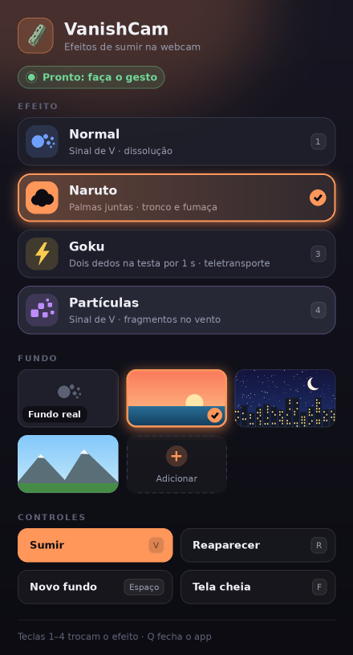

# Control panel and backgrounds

[← Documentation](README.md)



The **VanishCam** panel opens next to the video. Everything you click lives here, so the video you send to a call shows only you and the effect.

The panel is styled like a broadcast control surface: a light faceplate, black ink, and a single red signal color for whatever is live.

## What is on the panel

**Status line and tally lamp** — say what is happening right now:

| Lamp | Meaning |
| --- | --- |
| Green | Ready: make the gesture |
| Amber | Capturing the background: step out of the frame |
| Red | Vanishing, invisible, or reappearing |

**A · Efeito** — click a row, or press `1`–`4`, to switch effect. The active one is the inverted row marked **■ ATIVO**. Switching keeps the camera, the virtual webcam, the call microphone, and the background as they are: no restart, no new calibration.

**B · Fundo** — choose what is behind you:

- **REAL** is your room. It is hatched until it has been captured.
- **IMG 01**, **IMG 02**… are your pictures. The chosen one has a thick black frame.
- **ADICIONAR** opens your system's file picker and copies the picture into the gallery (up to 7; the oldest is removed first).
- Hover over a picture and click **×** to remove it from the gallery. Your original file is never touched.

**C · Controles** — the same actions as the keyboard: **SUMIR** (`V`), **REAPARECER** (`R`), **NOVO FUNDO** (`SPACE`), **TELA CHEIA** (`F`). Keys that do not apply right now are greyed out.

<br clear="right">

## Using a picture as your background

Pick it in **B · Fundo**, or start the app with one from the command line:

```bash
.venv/bin/python vanish_cam.py --background-image ~/Pictures/beach.jpg
```

```powershell
local_app\AVVIA_LOCALE.bat --background-image C:\Users\me\Pictures\beach.jpg
```

- The picture fills the whole frame without being stretched (the excess is cropped from the center) and is never mirrored.
- You appear in front of it, and when you vanish, the picture is what remains.
- There is no 4-second calibration while a picture is selected, and **NOVO FUNDO** (`SPACE`) is disabled.
- Going back to **REAL** reuses the room already captured. It only asks you to step out of the frame if the room was never captured in this session.
- Turn off the call app's own background effects (blur, virtual background) so they do not stack with this one.

## Keyboard shortcuts

They work in both the video window and the panel:

| Key | Action |
| --- | --- |
| `1`–`4` | Switch effect (Normal, Naruto, Goku, Partículas) |
| `V` | Vanish now, without the gesture |
| `R` | Reappear |
| `SPACE` | Capture a new real background |
| `F` | Toggle fullscreen |
| `Q` or `ESC` | Quit and release the camera |

`V` and `R` are disabled in Goku mode. Closing the panel window also quits the app.

## Saved preferences

The app remembers the last effect and background and starts with them next time. `--mode` and `--background-image` override them for one launch.

| System | Folder |
| --- | --- |
| Linux | `~/.config/vanishcam/` |
| Windows | `%APPDATA%\VanishCam\` |

The folder holds `settings.json` and a `backgrounds/` folder with the copies of your gallery pictures. Delete it to start fresh.
